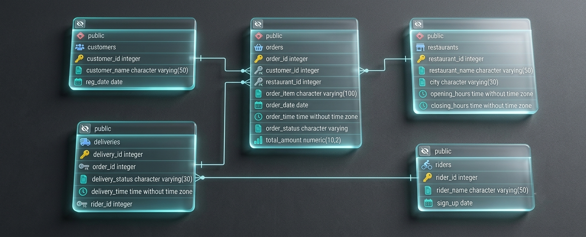

# Restaurant Orders & Delivery Analytics (PostgreSQL)

A SQL portfolio project that analyzes restaurant orders, customer
behavior, restaurant revenue, delivery performance, and rider earnings
using PostgreSQL.

## Project Overview

This project uses a relational database to explore operational and
business questions for a food-ordering platform. It includes table
creation, foreign-key relationships, basic data-quality checks, and
analytical SQL queries using joins, aggregate functions, CTEs, window
functions, date/time functions, conditional aggregation, and subqueries.

## Database ERD

The Entity Relationship Diagram (ERD) below shows the relationships between customers, orders, restaurants, deliveries, and riders.



## Database Schema

The project contains five tables:

  -----------------------------------------------------------------------
  Table                   Purpose                 Key columns
  ----------------------- ----------------------- -----------------------
  `customers`             Stores customer details `customer_id`,
                                                  `customer_name`,
                                                  `reg_date`

  `restaurants`           Stores restaurant       `restaurant_id`,
                          details and operating   `restaurant_name`,
                          hours                   `city`,
                                                  `opening_hours`,
                                                  `closing_hours`

  `riders`                Stores delivery rider   `rider_id`,
                          details                 `rider_name`, `sign_up`

  `orders`                Stores customer orders  `order_id`,
                          and order values        `customer_id`,
                                                  `restaurant_id`,
                                                  `order_item`,
                                                  `order_date`,
                                                  `order_time`,
                                                  `order_status`,
                                                  `total_amount`

  `deliveries`            Stores delivery status, `delivery_id`,
                          delivery time, and      `order_id`,
                          assigned rider          `delivery_status`,
                                                  `delivery_time`,
                                                  `rider_id`
  -----------------------------------------------------------------------

### Relationships

-   Each order references a customer through `orders.customer_id`.
-   Each order references a restaurant through `orders.restaurant_id`.
-   Each delivery references an order through `deliveries.order_id`.
-   Each delivery references a rider through `deliveries.rider_id`,
    enforced by the `delivery_rider_fk` foreign-key constraint.

### Order and delivery statuses

The `orders.order_status` constraint permits `Completed`, `Pending`,
`Cancelled`, and `Refunded`.

The `deliveries.delivery_status` constraint permits `Delivered`,
`Not Delivered`, and `Order` in the supplied schema.

## Technologies

-   **Database:** PostgreSQL
-   **Language:** SQL
-   **Topics:** relational modeling, joins, aggregation, data-quality
    checks, CTEs, window functions, date/time analysis, conditional
    aggregation, and subqueries

## Setup

Run the table-creation statements in PostgreSQL in this order:

1.  Create `customers`.
2.  Create `restaurants`.
3.  Create `riders`.
4.  Create `orders`.
5.  Create `deliveries`.
6.  Add the rider foreign key to `deliveries` using `ALTER TABLE`.

Example connection workflow using `psql`:

``` bash
psql -U your_username -d your_database
```

Then run the schema SQL file:

``` sql
\i path/to/schema.sql
```

Replace `your_username`, `your_database`, and the file path with your
local PostgreSQL details.

After loading data, you can inspect each table:

``` sql
SELECT * FROM customers;
SELECT * FROM restaurants;
SELECT * FROM riders;
SELECT * FROM orders;
SELECT * FROM deliveries;
```

## Data Quality Checks

The SQL script includes checks for `NULL` values in important columns
across all five tables. These checks help identify missing IDs, names,
dates, statuses, order values, and delivery details.

Example:

``` sql
SELECT COUNT(*)
FROM customers
WHERE customer_id IS NULL
   OR customer_name IS NULL
   OR reg_date IS NULL;
```

Note: `COUNT(*)` with a `WHERE` clause counts rows where at least one
listed field is `NULL`; it does not report a separate count for each
column.

## Business Questions and Analysis

The query collection covers the following analyses:

1.  **Top dishes for a customer** --- finds the most frequently ordered
    dishes for a named customer over the last year.
2.  **Popular ordering time slots** --- groups orders into two-hour
    intervals using `EXTRACT()` and `FLOOR()`.
3.  **Customer order value analysis** --- calculates customer-level
    spending and average order value, with an order-count threshold.
4.  **High-value customers** --- identifies customers whose total
    spending exceeds a specified threshold.
5.  **Orders without successful delivery** --- counts not-delivered
    orders by restaurant and city.
6.  **Restaurant revenue ranking** --- ranks restaurant revenue within
    each city over a recent one-year period.
7.  **Most popular dish by city** --- counts orders by city and dish,
    then uses `ROW_NUMBER()` to select one top dish per city.
8.  **Customer churn** --- finds customers who ordered in 2025 but did
    not order in 2026, using `EXISTS` and `NOT EXISTS`.
9.  **Cancellation rate comparison** --- compares cancelled orders with
    total orders for each restaurant in 2025 and 2026.
10. **Rider average delivery duration** --- estimates elapsed minutes
    between order time and delivery time, accounting for deliveries that
    cross midnight.
11. **Monthly restaurant growth** --- compares monthly delivered-order
    counts with the previous available month using `DATE_TRUNC()` and
    `LAG()`.
12. **Customer segmentation** --- categorizes customers into Gold and
    Silver groups based on spending relative to average order value,
    then summarizes segments.
13. **Rider monthly earnings** --- estimates rider earnings at 8% of
    order amounts.
14. **Order frequency by weekday** --- identifies each restaurant's peak
    ordering day.
15. **Customer lifetime value** --- calculates total order revenue
    generated by each customer.

## SQL Concepts Demonstrated

-   `INNER JOIN` and foreign-key relationships
-   `COUNT()`, `SUM()`, and `AVG()`
-   `GROUP BY` and `HAVING`
-   `CASE WHEN`
-   `COUNT(*) FILTER (WHERE ...)`
-   Common Table Expressions (`WITH`)
-   Window functions: `RANK()`, `ROW_NUMBER()`, and `LAG()`
-   Date functions: `CURRENT_DATE`, `INTERVAL`, `DATE_TRUNC()`,
    `TO_CHAR()`, and `EXTRACT()`
-   Subqueries with `EXISTS` and `NOT EXISTS`
-   Safe division with `NULLIF()`
-   Sorting and limiting results with `ORDER BY` and `LIMIT`

## Important Validation Notes

Before publishing results, verify that the SQL matches each question's
wording and your intended business definition:

-   Some comments and query thresholds in the supplied script differ.
    For example, the customer order-count threshold and high-value
    spending threshold should be confirmed.
-   For revenue ranking, use descending revenue order if rank 1 should
    mean the highest revenue.
-   The cancellation rate denominator should include all orders in the
    relevant year, not only cancelled orders.
-   Monthly growth based on `LAG()` compares the previous row available
    for a restaurant. Months with no delivered orders are absent unless
    a calendar-month series is generated.
-   The weekday query should use a stable weekday key for ranking and a
    formatted day name for display, so weekday names are not sorted
    alphabetically for chronological reporting.
-   The rider duration calculation assumes `order_time` and
    `delivery_time` are times on the same delivery timeline and uses a
    midnight-crossing adjustment. If possible, timestamps with dates are
    more reliable.
-   The schema's delivery-status constraint includes the value `Order`;
    confirm that this is intentional for your dataset.

## Suggested Repository Structure

``` text
restaurant-orders-delivery-analytics/
├── README.md
├── schema.sql
├── analysis_queries.sql
└── data/
    └── (source CSV files, if applicable)
```

Keep table definitions in `schema.sql` and analytical queries in
`analysis_queries.sql` to make the project easier to navigate and
maintain.

## Project Outcome

This project demonstrates how SQL can be used to transform restaurant
order and delivery records into business insights about customer
retention, dish popularity, revenue, cancellations, delivery
performance, and rider earnings.

------------------------------------------------------------------------

**Database:** PostgreSQL\
**Project type:** SQL Data Analysis / Portfolio Project
